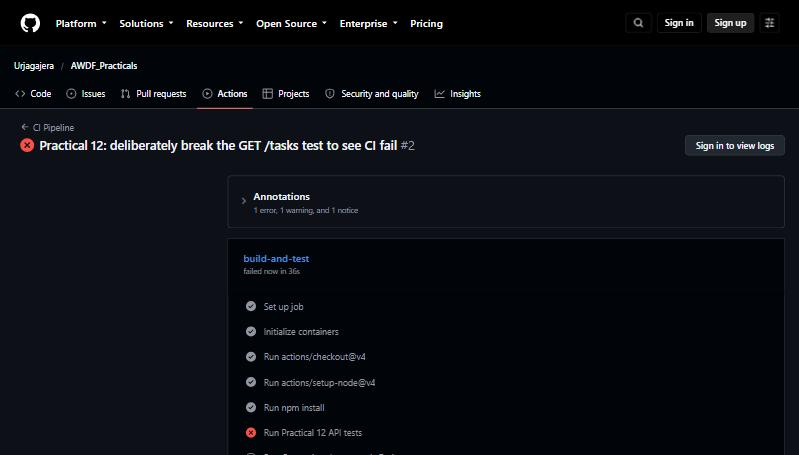
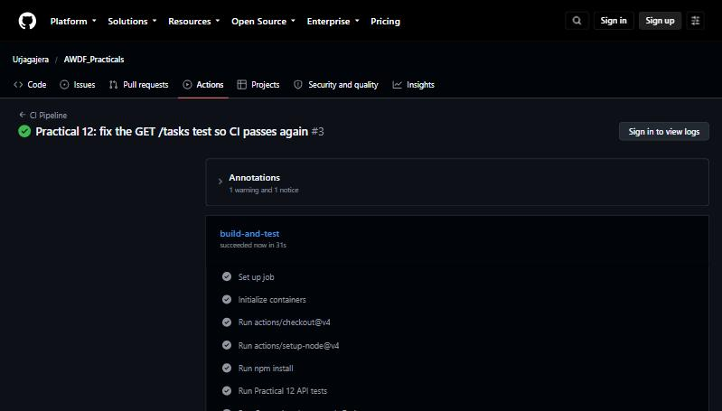

# Practical 12 — CI/CD Pipeline with GitHub Actions

[](https://github.com/khushiundhad07/24CS101_practical_12_ADWDF/actions/workflows/ci.yml)

**CO5 / PO3, PO5** · Objective: automate testing of the application with a CI pipeline.

`server/` is the Task API from Practical 11 with a Jest + Supertest test suite. The workflow lives at the
repository root, **`.github/workflows/ci.yml`**, and runs every step inside `server/`.

## Pipeline

```
git push origin main
        │
        ▼
GitHub Actions trigger (on: push, branches: [main])
        │
        ▼
Job: lint ────────────── checkout → setup Node 18 → npm ci → eslint
        │ needs: lint
        ▼
Job: build-and-test ──── MongoDB service container
                         checkout → setup Node 18 → npm ci → type-check → npm test
        │
        ▼
✔ green check (pass)  or  ✖ red X (fail) on the commit
```

## Tests — `server/tests/tasks.test.ts`

| Test | Checks |
|---|---|
| `GET /tasks returns 200` | the lab sheet's test; logs in first, because task routes need a JWT since Practical 7 |
| `GET /tasks without a token returns 401` | the auth middleware |
| `POST /tasks creates a task that GET /tasks then returns` | create → read round trip, title trimmed |
| `POST /tasks without a title is rejected with 400` | validation middleware |
| `POST /auth/login with a wrong password returns 401` | login |

Tests use their own database (`awdf_p12_test`), dropped before and after each run. In CI that database is a
`mongo:7` service container.

```bash
cd server
npm install
npm test          # needs MongoDB on localhost:27017 (or set MONGO_URI)
npm run lint
```

## Problem statement → what happened

| Requirement | Evidence |
|---|---|
| Workflow runs on every push to `main` | `on: push: branches: [main]` — every commit since has a run |
| Installs dependencies as a step | `- run: npm ci` |
| At least one automated test with pass/fail | `npm test` step; run [#1](https://github.com/Urjagajera/AWDF_Practicals/actions/runs/39606453704) passed |
| A failed pipeline from a deliberately broken test | commit `60f2331` expected 201 from `GET /tasks` → run [#2](https://github.com/Urjagajera/AWDF_Practicals/actions/runs/39606690500) **failed** at *Run Practical 12 API tests* (`Expected: 201, Received: 200`, exit code 1) |
| The pipeline passing after the fix | commit `42f0ac5` → run [#3](https://github.com/Urjagajera/AWDF_Practicals/actions/runs/39606947452) **passed** |

| Failed run (#2) | Passed run (#3) |
|---|---|
|  |  |

**Supplementary / post-lab:**

- A **lint job** (ESLint + typescript-eslint) that must pass before the test job runs (`needs: lint`).
- A **status badge** at the top of this README (and of the root README).
- **More tests** covering other endpoints (table above).
- *Run only on pull requests to main* — not switched on, because the lab's main requirement is a run on every
  push to main. It would be:
  ```yaml
  on:
    pull_request:
      branches: [main]
  ```

## Key questions

**CI vs CD — which does this practical show?** Continuous Integration: every push is automatically
installed, linted, type-checked and tested, so broken code is caught as soon as it lands. Continuous
Deployment would go further and, when the pipeline passes, automatically release the build (for example,
push the Practical 11 images and update a server). This pipeline stops at the green check — it is CI.

**Why does running tests on every push catch problems earlier?** Each run checks one small change, so a
failure points straight at the commit that caused it (here, run #2 failed on exactly the commit that changed
the test). Manual testing before a release checks weeks of changes at once — failures are harder to trace,
and things people forget to test slip through.

**What if the test file path were wrong — same failure step?** The job would still fail in the *Run … tests*
step, but for a different reason: Jest prints `No tests found, exiting with code 1` instead of an assertion
diff. The red X looks the same, which is why the logs matter — the cause is in the step's output, not the icon.

## Errors met along the way

- `npm install` failed locally with `EJSONPARSE` after I edited `package.json` with `sed`: it had left a stray
  backslash before the em dash in the description. Rewriting the file properly fixed it.
- Once a second test file was planned, both files would drop the same test database in parallel; the tests
  were kept in one file and `jest --runInBand` makes Jest run files one after another.
- Every run shows a warning that `actions/checkout@v4` and `actions/setup-node@v4` target the deprecated
  Node.js 20 runtime. They still work (GitHub forces them onto Node 24); `@v4` is kept because it matches the
  lab sheet.
